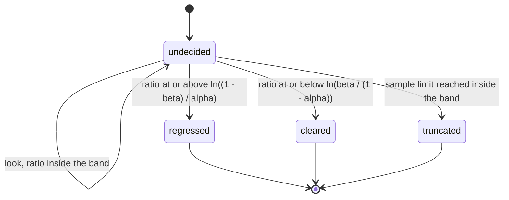
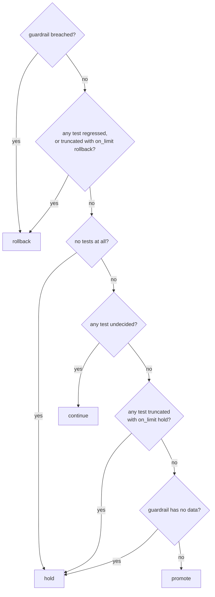

# CanaryMachines

> "Looks fine so far" is not a statistical test. 🐤

Sequential canary analysis for Ruby. Before the rollout starts you write down two hypotheses, how often you can live with being wrong, and how many samples you are willing to spend. Then you feed it counts as they arrive. Each look answers with one of three things: the evidence says regression, the evidence says no regression, or keep sampling. A canary of several tests folds those into one recommendation: promote, roll back, continue or hold. It recommends. It never touches your deployment.

## Quick Start

```bash
gem 'canary_machines'
```

```ruby
CM = CanaryMachines

canary = CM::Canary.new(rollout.id)

# Acceptable: 1 failure in 1000. Unacceptable: 5 in 1000.
model = CM::Model::Reference.new(CM::Rate.new(1, 1000), CM::Rate.new(5, 1000))
level = CM::Rate.new(5, 100)
errors = canary.add(CM::Plan.new(model, level, level, 50_000, :hold))   # model, alpha, beta, limit, on_limit

every_minute do |window|
  now = Process.clock_gettime(Process::CLOCK_MONOTONIC, :nanosecond)
  canary.observe_trials(rollout.id, now, errors, CM::Counts.new(window.good, window.total))

  case canary.recommend(slo_guardrail).action   # :clear, :no_data or :breached
  when :promote  then rollout.promote!
  when :rollback then rollout.abort!
  when :hold     then page_a_human
  end # :continue, see you in a minute
end
```

One canary, up to eight tests. `CM` is only an alias to keep the lines short. Every value has the name and the fields of the Rust type it mirrors: a `Rate` is `num` over `den`, a `Plan` is the five arguments of the core's `Plan::new`. Counts are Integers, and instants are Integer nanoseconds of monotonic time. The `promote!` and `abort!` are yours.

## A Message to the Resistance

So you shipped the canary to 5% of traffic and opened the dashboard. Two lines, baseline and canary. The canary line is a little higher. You wait five minutes. Now it's a little lower. You wait five more. Somebody in the channel says "looks fine to me" and you promote, because it's 5pm and the lines were close.

That was a statistical test. It had a stopping rule ("when I got bored"), a decision threshold ("the lines looked close"), and an error rate nobody has ever computed. Run it every deploy and it will pass regressions and fail healthy builds at whatever frequency your patience and your monitor size happen to produce.

The honest version was worked out in 1943 for inspecting munitions, by a man who was not allowed to read his own classified report. You fix the two rates you want to tell apart and the two error probabilities you can afford. You accumulate a log-likelihood ratio. You stop the first time it leaves a band, and not before. That's this gem, in integers.

## Chapter 1: Stardate 2026.316, the AMS Wald

> **AMS Wald**, NCC-4226, *Wald*-class proving scout.
> The scout goes through the gate first, and reports. It does not decide who follows.

The proving scout flies ahead of the convoy through a freshly opened gate and counts what it finds: transits that went clean, transits that didn't. The fleet does not want its opinion. The fleet wants to know one thing, as early as the evidence allows and no earlier: is this gate worse than the charts say it should be?

On the bridge, a cadet has been watching the tally:

```ruby
def healthy?(canary, baseline)
  canary.error_rate <= baseline.error_rate * 1.1
end

promote! if healthy?(canary, baseline) # checked every 30 seconds until true
```

"That," says the scout's proving officer, "is a coin you flip until it lands the way you'd like."

## The Flight Plan

Each test accumulates a log-likelihood ratio and latches the first time it leaves the band:



And the recommendation for the whole rollout, first match wins:



## How the Canary Works

### A test against a fixed reference

```ruby
canary = CM::Canary.new(1)   # rollout generation 1
level = CM::Rate.new(5, 100)
reference = CM::Model::Reference.new(CM::Rate.new(1, 1000), CM::Rate.new(5, 1000))
errors = canary.add(CM::Plan.new(reference, level, level, 50_000, :hold))
# => 0, the test's index
canary.plan(errors).limit   # => 50000
```

A `Plan` is the core's: `model`, `alpha`, `beta`, `limit`, `on_limit`, in that order, all required. There is no default for what a spent limit means. The model is one of the two variants of the core's `Model`, `Model::Reference` or `Model::Paired`, each holding its `acceptable` and `unacceptable` hypothesis. A plan that the core would not build never exists: `Plan.new` raises `RangeError` for hypotheses out of order or too close to tell apart, `alpha + beta >= 1`, or a zero limit.

`add` answers the new test's index, or refuses with `:full`. `plan(index)` hands the plan back, or `nil` for an index with no test.

`Rate.failure_of(objective)` takes the acceptable rate straight from an SLO: it reads the `good` and `per` of a [budget_machines](https://github.com/seuros/budget_machines) `Objective` (or of anything with those two readers) and answers the failure rate it tolerates, or `nil` for an objective that tolerates every event.

The sampling model: each canary request is an independent trial that fails with one probability `p`. `H0` says `p` is at most the acceptable rate, `H1` says it is at least the unacceptable one. Between them is the zone you have declared you don't care about.

The baseline here is a number you chose, not a sample. That is the point. If you take last week's baseline error rate and type it in as the acceptable rate, the test treats it as exact, and any uncertainty in it is now yours. If the baseline is being measured at the same time as the canary, use a paired test instead.

### A paired test against a live baseline

```ruby
paired = CM::Model::Paired.new(CM::OddsRatio.new(1, 1), CM::OddsRatio.new(2, 1))
latency = canary.add(CM::Plan.new(paired, level, level, 20_000, :rollback))
```

The sampling model: baseline and canary are sampled concurrently and matched into pairs, one request from each, by a rule that doesn't look at outcomes. Pairs where both arms succeeded or both failed are discarded as evidence. Among the pairs that disagree, the canary is the failing side with probability `psi / (1 + psi)`, where `psi` is the odds ratio of canary failure to baseline failure. The baseline's own failure rate cancels out of that, so it never has to be known, and it's allowed to drift as long as both halves of a pair see the same conditions.

`H0` says the odds ratio is at most `acceptable` (`1/1`: no worse than baseline). `H1` says it is at least `unacceptable` (`2/1`: twice the odds).

Two totals, "baseline had 40 failures in 10 000, canary had 9 in 500", are not pairs and cannot be fed to this test. There's no method that accepts them, on purpose.

### Observe

```ruby
minute = 60_000_000_000   # instants are Integer nanoseconds
t0 = Process.clock_gettime(Process::CLOCK_MONOTONIC, :nanosecond)

canary.observe_trials(1, t0, errors, CM::Counts.new(500, 500))
# => Status(look: Look(outcome: :undecided, hits: 0, misses: 500, samples: 500, llr_micro: -2006021),
#           decided_at: nil)

canary.observe_trials(1, t0 + minute, errors, CM::Counts.new(233, 233)).look.outcome   # => :undecided
done = canary.observe_trials(1, t0 + (2 * minute), errors, CM::Counts.new(1, 1))
# => Status(look: Look(outcome: :cleared, hits: 0, misses: 734, samples: 734, llr_micro: -2944839),
#           decided_at: ...)
done.decided?                          # => true
done.decided_at == t0 + (2 * minute)   # => true
canary.last == t0 + (2 * minute)       # => true
```

Arguments are the generation, the instant, the test, and the new counts since the last look. Not running totals. The counts are a `Counts` (`good`, `total`); a `BudgetMachines::Counts`, or anything else with those two readers, is read the same way. The instant is Integer nanoseconds from a monotonic clock; `decided_at` and `last` come back in the same unit. A `Status` is the core's: a `Look` (`outcome`, `hits`, `misses`, `samples`, `llr_micro`) and `decided_at`. `llr_micro` is the log-likelihood ratio in millionths of a nat; the plan's `lower_micro` and `upper_micro` tell you where the band is:

```ruby
plan = canary.plan(errors)
plan.lower_micro   # => -2944439, at or below it the test is cleared
plan.upper_micro   # => 2944438, at or above it the test is regressed
```

A paired test takes a `Pairs` (`canary_only`, `baseline_only`, `concordant`):

```ruby
canary.observe_pairs(1, t0 + (3 * minute), latency, CM::Pairs.new(9, 2, 989)).look.outcome
# => :undecided
canary.observe_pairs(1, t0 + (4 * minute), latency, CM::Pairs.new(9, 1, 990)).look
# => Look(outcome: :regressed, hits: 18, misses: 3, samples: 2000, llr_micro: 3961881)
```

`observe_trials` and `observe_pairs` are the two variants of the core's `Observation`. Each answers the test's `Status`, or refuses with `:stale_generation`, `:time_regression`, `:unknown_test`, `:wrong_model`, `:concluded` or `:overflow`.

The test is evaluated once per call, at the end of the batch. Once an outcome latches, the test is finished and further observations come back `:concluded`.

### Recommend

```ruby
canary.recommend(:clear)
# => Recommendation(action: :rollback, reason: :evidence, test: 1)
```

One regressed test is enough to recommend rollback. Promotion needs every test cleared. `recommend` takes the guardrail's verdict, always: pass `:clear` when you have no guardrail. It doesn't change anything and never refuses, so ask as often as you like.

### The guardrail

```ruby
canary.recommend(:clear)      # measured and healthy, or you have none
canary.recommend(:no_data)    # a would-be promote becomes hold, reason :guardrail_no_data
canary.recommend(:breached)   # rollback, reason :guardrail, whatever the tests say
```

The guardrail is somebody else's verdict that you pass in, such as a [budget_machines](https://github.com/seuros/budget_machines) burn-rate alert. `Guardrail.from` is the core's conversion from one:

```ruby
CM::Guardrail.from(:firing)            # => :breached   a rule's state: :quiet is :clear, :no_data is :no_data
CM::Guardrail.from(account.standing)   # => :breached when exhausted, :clear when within, :no_data when :no_data
```

It reads a budget standing by its `remaining` or `overspent` reader, so the budget gem is not a dependency. A sequential test that needs 700 requests to make up its mind should not be what stands between you and a rollback while the error budget is on fire.

### The sample limit

```ruby
short = CM::Canary.new(1)
test = short.add(CM::Plan.new(reference, level, level, 600, :hold))
short.observe_trials(1, t0, test, CM::Counts.new(599, 600)).look.outcome   # => :truncated
short.recommend(:clear)   # => Recommendation(action: :hold, reason: :limit, test: 0)
```

A test that reaches `limit` samples inside the band is `:truncated`. The limit counts everything, concordant pairs included. A batch may carry the count past the limit; the look still happens at the end of it, and a threshold reached on that look wins over truncation.

What truncation stands for is `on_limit`: `:hold`, `:rollback` or `:promote`. You have to say which.

### The error bounds

```ruby
canary.plan(errors).bounds
# => Bounds(false_rollback: Fraction(num: 500, den: 9500), false_promote: Fraction(num: 500, den: 9500))
canary.plan(latency).bounds
# => Bounds(false_rollback: nil, false_promote: Fraction(num: 500, den: 9500))
```

A bound is the core's `Fraction`, `num` over `den`, exact and not reduced: `Rational(bound.num, bound.den)` is `1/19`.

These are Wald's inequalities, and they are what this gem claims, exactly:

- When `H0` is true, a test ends `:regressed` with probability at most `alpha / (1 - beta)`.
- When `H1` is true, a test ends `:cleared` with probability at most `beta / (1 - alpha)`.

Not `alpha` and `beta` themselves. Those are the nominal levels the thresholds are built from; the guaranteed bounds are slightly larger, and the two real error rates sum to at most `alpha + beta`.

The limit changes what the bounds cover. With `on_limit: :hold` both hold at any limit, because truncation is not a decision; what you lose is the promise of ever getting one. With `on_limit: :rollback`, every truncation under `H0` is one more false rollback, so that bound is gone and `false_rollback` is `nil`. With `on_limit: :promote` it's `false_promote` that is `nil`. A short limit with a forced decision is a fixed-sample test you haven't computed the error rates of.

The bounds are per test. Across several tests, the chance that some healthy test recommends rollback is at most the sum of their `false_rollback` bounds. And they are bounds on the statistics only: a guardrail rollback is not a statistical error and is not counted.

### A new attempt

```ruby
canary.restart(2)                                             # => :ok
canary.observe_trials(1, t0 + (5 * minute), errors, CM::Counts.new(1, 1))   # => :stale_generation
canary.status(errors).look.samples                            # => 0
```

`restart` keeps every test's plan and drops its evidence. The generation must go up. `restart` answers `:ok`, or refuses with `:stale_generation`. Observations tagged with any other generation are refused, so a metrics window from the build you just rolled back can't leak into the next one.

### Capacity

```ruby
canary = CM::Canary.new(1)
canary.capacity         # => 8
plan = CM::Plan.new(paired, level, level, 100, :hold)
8.times { canary.add(plan) }
canary.add(plan)        # => :full
canary.size     # => 8
canary.empty?   # => false
```

### Time only moves forward

```ruby
canary = CM::Canary.new(1)
test = canary.add(CM::Plan.new(reference, level, level, 1000, :hold))
canary.observe_trials(1, t0, test, CM::Counts.new(9, 10)).class   # => CanaryMachines::Status
canary.observe_trials(1, t0 - 1, test, CM::Counts.new(9, 10))     # => :time_regression
canary.observe_trials(1, t0, test, CM::Counts.new(9, 10)).class   # => CanaryMachines::Status
```

Instants are Integer nanoseconds of monotonic time, `Process.clock_gettime(Process::CLOCK_MONOTONIC, :nanosecond)`. The canary needs them not to go backwards, and it does not rewind them on `restart`.

### One test on its own

```ruby
sprt = CM::Sprt.new(CM::Plan.new(reference, level, level, 50_000, :hold))
sprt.observe_trials(CM::Counts.new(500, 500))
# => Look(outcome: :undecided, hits: 0, misses: 500, samples: 500, llr_micro: -2006021)
sprt.outcome   # => :undecided
sprt.look      # => the same Look
sprt.plan      # => the Plan
sprt.reset     # => nil, the evidence and any latched outcome are gone; the plan stays
```

`Sprt` is the core's single test, without a generation, a clock or a recommendation. `observe_trials` and `observe_pairs` answer the `Look` after the batch, or refuse with `:concluded`, `:wrong_model` or `:overflow`. `reset` is always honoured.

### The arithmetic, in the open

```ruby
plan = canary.plan(test)
plan.upper   # => Interval(lo: ..., hi: ...) around ln((1 - beta) / alpha)
plan.lower   # => Interval around ln(beta / (1 - alpha))
plan.hit     # => Interval around the weight of one hit, above zero
plan.miss    # => Interval around the weight of one miss, below zero
CM.micro_nats(plan.upper.hi) == plan.upper_micro   # => true
CM::FRACTION_BITS                                  # => 48
```

An `Interval` is `lo` and `hi`, Integers in units of `2**-FRACTION_BITS` nat, and `micro_nats` is the one conversion behind every `*_micro` reading.

## The Rules of the Scout

- **Time is Integer nanoseconds.** The instant of `observe_trials` and `observe_pairs`, `Status#decided_at` and `Canary#last`. A Float, a Rational or anything else that isn't an Integer raises `TypeError`; negative or past `2**64-1` raises `RangeError`. A `limit` counts samples and a generation is an opaque number; neither is time.
- **Everything is an Integer.** Counts, limits, generations and instants are in `0..2**64-1`; the two parts of a `Rate` or an `OddsRatio` are in `0..2**32-1`. A Float, a Rational, a String or `nil` raises `TypeError`, and so does an Array or a Hash where a `Plan`, a model, a `Rate`, a `Counts` or a `Pairs` belongs. A rate outside `(0, 1)`, a zero in an odds ratio, hypotheses in the wrong order, `alpha + beta >= 1`, a zero limit, `good > total`, or pair counts that don't sum within 64 bits raise `RangeError` when the value is built, so an invalid one never exists. An unknown `on_limit` or guardrail symbol raises `ArgumentError`.
- **Refusals don't raise.** `:stale_generation`, `:time_regression`, `:unknown_test`, `:wrong_model`, `:concluded`, `:overflow` and `:full` are answers, and a refused call changes nothing.
- **Every answer, by method.**

  | Method | Honoured | Refused |
  | --- | --- | --- |
  | `Canary#add(plan)` | the test's index (Integer) | `:full` |
  | `Canary#observe_trials(generation, at, index, counts)`, `Canary#observe_pairs(generation, at, index, pairs)` | the test's `Status` | `:stale_generation`, `:time_regression`, `:unknown_test`, `:wrong_model`, `:concluded`, `:overflow` |
  | `Canary#restart(generation)` | `:ok` | `:stale_generation` |
  | `Sprt#observe_trials(counts)`, `Sprt#observe_pairs(pairs)` | the `Look` | `:concluded`, `:wrong_model`, `:overflow` |
  | `Sprt#reset` | `nil` | never |

  `recommend` always answers a `Recommendation`. `Canary#status` and `Canary#plan` answer `nil` for an index with no test. Those seven symbols are every variant of the core's `Refusal`, and each is reachable. There is no catch-all symbol.
- **Ruby mirrors Rust.** `Rate`, `OddsRatio`, `Counts`, `Pairs`, `Plan`, `Interval`, `Fraction`, `Bounds`, `Look`, `Status` and `Recommendation` have the fields of the core's structs, in order, and are passed positionally where the core takes them. An enum whose variants carry something is a module of `Data` values named after them (`Model::Reference`, `Model::Paired`); the rest are symbols, the core's variants in snake case: outcomes, actions, reasons, `on_limit` and the guardrail. `Canary#size` is the core's `len`. The core's `Observation` is the choice between `observe_trials` and `observe_pairs`.
- **Outcomes latch.** A decided test stays decided until `restart`. There's no "look again, maybe it's better now".
- **No floats inside.** Logarithms are computed in integer arithmetic and carried as intervals with 48 fraction bits. A threshold counts as reached only when the whole interval is past it, so rounding can delay a decision by a hair and can never invent one. Two machines never disagree.
- **Frozen means frozen.** `freeze` a canary and `add`, `observe_*` and `restart` raise `FrozenError`; `freeze` an `Sprt` and `observe_*` and `reset` do. `recommend` and every reader still answer.

## What You Think You're Doing vs Reality

### You Think: "I'll check the canary every minute and promote once it looks healthy."
### Reality: You'll stop on a lucky minute.

A noisy metric crosses any fixed line eventually if you keep looking, in either direction. Checking repeatedly and stopping on the first agreeable reading is how a 5% false-positive test becomes a 30% one, or worse. A sequential test is the one kind of test designed to be peeked at: its thresholds already account for every look you're going to take.

### You Think: "The canary's error rate is below the baseline's, ship it."
### Reality: The baseline's error rate is also a guess.

Two aggregate counts give you two noisy estimates and no model of how they relate. Treat the baseline estimate as the truth and you've hidden half the variance. Either commit to a reference rate in advance and own it, or sample both arms together and test the pairs.

### You Think: "It hit the sample limit without failing, so it passed."
### Reality: It hit the sample limit without deciding.

Not enough evidence to call a regression is also not enough to rule one out. That's what `:truncated` means, and why `on_limit: :hold` is the honest answer unless you have computed a better one.

## What's Yours

This is an initial release with an unstable API. It's a policy core, not a runtime: no clock, no metrics client, no storage, no threads, and no hand on the deployment. The canary lives in your process and forgets everything when the process does.

You own the sampling model. The bounds hold if canary trials really are independent with one failure probability, and if pairs really are matched without looking at outcomes. Retries, sticky sessions, one bad host and a traffic mix that shifts mid-rollout all break that, and nothing in here can detect it. You own the look schedule too: when to look may depend on what you have already fed the test, never on data it hasn't seen. You own what a "good" request is, the guardrail's verdict, and above all the promote and the rollback.

## License

MIT License. See [LICENSE.txt](LICENSE.txt) for details.

**Remember: the canary doesn't get a vote. It gets counted.**
