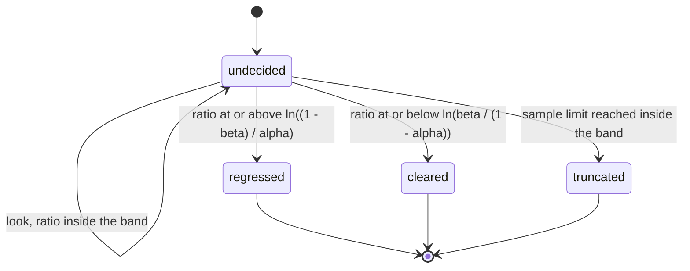
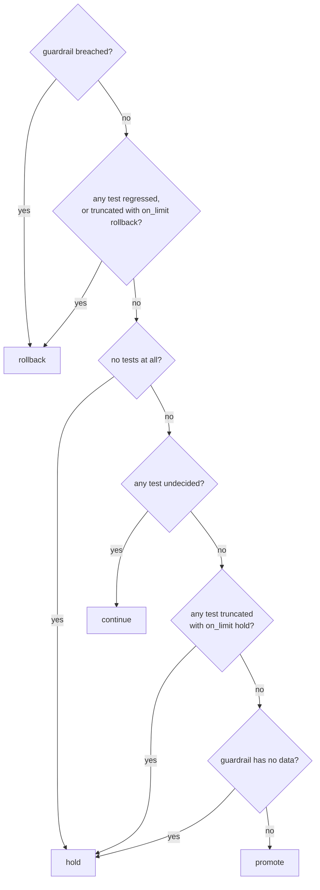

# CanaryMachines

> "Looks fine so far" is not a statistical test. 🐤

Sequential canary analysis for Ruby. Before the rollout starts you write down two hypotheses, how often you can live with being wrong, and how many samples you are willing to spend. Then you feed it counts as they arrive. Each look answers with one of three things: the evidence says regression, the evidence says no regression, or keep sampling. A canary of several tests folds those into one recommendation: promote, roll back, continue or hold. It recommends. It never touches your deployment.

## Quick Start

```bash
gem 'canary_machines'
```

```ruby
canary = CanaryMachines::Canary.new(rollout.id)

# Acceptable: 1 failure in 1000. Unacceptable: 5 in 1000.
errors = canary.add_reference(1/1000r, 5/1000r, alpha: 5/100r, beta: 5/100r, limit: 50_000)

every_minute do |window|
  canary.observe_trials(rollout.id, clock.now, errors, good: window.good, total: window.total)

  case canary.recommend(slo_guardrail).action
  when :promote  then rollout.promote!
  when :rollback then rollout.abort!
  when :hold     then page_a_human
  end # :continue, see you in a minute
end
```

One canary, up to eight tests. Rates are Rationals, counts and instants are Integers. The `promote!` and `abort!` are yours.

## A Message to the Resistance

So you shipped the canary to 5% of traffic and opened the dashboard. Two lines, baseline and canary. The canary line is a little higher. You wait five minutes. Now it's a little lower. You wait five more. Somebody in the channel says "looks fine to me" and you promote, because it's 5pm and the lines were close.

That was a statistical test. It had a stopping rule ("when I got bored"), a decision threshold ("the lines looked close"), and an error rate nobody has ever computed. Run it every deploy and it will pass regressions and fail healthy builds at whatever frequency your patience and your monitor size happen to produce.

The honest version was worked out in 1943 for inspecting munitions, by a man who was not allowed to read his own classified report. You fix the two rates you want to tell apart and the two error probabilities you can afford. You accumulate a log-likelihood ratio. You stop the first time it leaves a band, and not before. That's this gem, in integers.

## Chapter 1: Stardate 2026.316, the AMS Wald

> **AMS Wald**, NCC-4226, *Wald*-class proving scout.
> The scout goes through the gate first, and reports. It does not decide who follows.

The proving scout flies ahead of the convoy through a freshly opened gate and counts what it finds: transits that went clean, transits that didn't. The fleet does not want its opinion. The fleet wants to know one thing, as early as the evidence allows and no earlier: is this gate worse than the charts say it should be?

On the bridge, a cadet has been watching the tally:

```ruby
def healthy?(canary, baseline)
  canary.error_rate <= baseline.error_rate * 1.1
end

promote! if healthy?(canary, baseline) # checked every 30 seconds until true
```

"That," says the scout's proving officer, "is a coin you flip until it lands the way you'd like."

## The Flight Plan

Each test accumulates a log-likelihood ratio and latches the first time it leaves the band:



And the recommendation for the whole rollout, first match wins:



## How the Canary Works

### A test against a fixed reference

```ruby
canary = CanaryMachines::Canary.new(1)   # rollout generation 1
errors = canary.add_reference(1/1000r, 5/1000r, alpha: 5/100r, beta: 5/100r, limit: 50_000)
# => 0, the test's index
```

The sampling model: each canary request is an independent trial that fails with one probability `p`. `H0` says `p` is at most the acceptable rate, `H1` says it is at least the unacceptable one. Between them is the zone you have declared you don't care about.

The baseline here is a number you chose, not a sample. That is the point. If you take last week's baseline error rate and type it in as the acceptable rate, the test treats it as exact, and any uncertainty in it is now yours. If the baseline is being measured at the same time as the canary, use a paired test instead.

### A paired test against a live baseline

```ruby
latency = canary.add_paired(1r, 2r, alpha: 5/100r, beta: 5/100r, limit: 20_000, on_limit: :rollback)
```

The sampling model: baseline and canary are sampled concurrently and matched into pairs, one request from each, by a rule that doesn't look at outcomes. Pairs where both arms succeeded or both failed are discarded as evidence. Among the pairs that disagree, the canary is the failing side with probability `psi / (1 + psi)`, where `psi` is the odds ratio of canary failure to baseline failure. The baseline's own failure rate cancels out of that, so it never has to be known, and it's allowed to drift as long as both halves of a pair see the same conditions.

`H0` says the odds ratio is at most the first argument (`1r`: no worse than baseline). `H1` says it is at least the second (`2r`: twice the odds).

Two totals, "baseline had 40 failures in 10 000, canary had 9 in 500", are not pairs and cannot be fed to this test. There's no method that accepts them, on purpose.

### Observe

```ruby
canary.observe_trials(1, 60, errors, good: 500, total: 500)
# => Status(outcome: :undecided, hits: 0, misses: 500, samples: 500, llr_micro: -2006021, decided_at: nil)

canary.observe_trials(1, 120, errors, good: 233, total: 233).outcome   # => :undecided
canary.observe_trials(1, 180, errors, good: 1, total: 1)
# => Status(outcome: :cleared, hits: 0, misses: 734, samples: 734, llr_micro: -2944839, decided_at: 180)
```

Arguments are the generation, the instant, the test, and the new counts since the last look. Not running totals. `llr_micro` is the log-likelihood ratio in millionths of a nat; `thresholds` tells you where the band is:

```ruby
canary.thresholds(errors)   # => [-2944439, 2944438]
```

A paired test takes pair counts:

```ruby
canary.observe_pairs(1, 190, latency, canary_only: 9, baseline_only: 2, concordant: 989).outcome
# => :undecided
canary.observe_pairs(1, 200, latency, canary_only: 9, baseline_only: 1, concordant: 990)
# => Status(outcome: :regressed, hits: 18, misses: 3, samples: 2000, llr_micro: 3961881, decided_at: 200)
```

The test is evaluated once per call, at the end of the batch. Once an outcome latches, the test is finished and further observations come back `:concluded`.

### Recommend

```ruby
canary.recommend
# => Recommendation(action: :rollback, reason: :evidence, test: 1)
```

One regressed test is enough to recommend rollback. Promotion needs every test cleared. `recommend` doesn't change anything, so ask as often as you like.

### The guardrail

```ruby
canary.recommend(:clear)      # the default
canary.recommend(:no_data)    # a would-be promote becomes hold, reason :guardrail_no_data
canary.recommend(:breached)   # rollback, reason :guardrail, whatever the tests say
```

The guardrail is somebody else's verdict that you pass in, such as a [budget_machines](https://github.com/seuros/budget_machines) burn-rate alert: `:firing` is `:breached`, `:quiet` is `:clear`, `:no_data` is `:no_data`. A sequential test that needs 700 requests to make up its mind should not be what stands between you and a rollback while the error budget is on fire.

### The sample limit

```ruby
short = CanaryMachines::Canary.new(1)
test = short.add_reference(1/1000r, 5/1000r, alpha: 5/100r, beta: 5/100r, limit: 600)
short.observe_trials(1, 0, test, good: 599, total: 600).outcome   # => :truncated
short.recommend   # => Recommendation(action: :hold, reason: :limit, test: 0)
```

A test that reaches `limit` samples inside the band is `:truncated`. The limit counts everything, concordant pairs included. A batch may carry the count past the limit; the look still happens at the end of it, and a threshold reached on that look wins over truncation.

What truncation stands for is `on_limit`: `:hold` (the default), `:rollback` or `:promote`.

### The error bounds

```ruby
canary.bounds(errors)
# => Bounds(false_rollback: (1/19), false_promote: (1/19))
canary.bounds(latency)
# => Bounds(false_rollback: nil, false_promote: (1/19))
```

These are Wald's inequalities, and they are what this gem claims, exactly:

- When `H0` is true, a test ends `:regressed` with probability at most `alpha / (1 - beta)`.
- When `H1` is true, a test ends `:cleared` with probability at most `beta / (1 - alpha)`.

Not `alpha` and `beta` themselves. Those are the nominal levels the thresholds are built from; the guaranteed bounds are slightly larger, and the two real error rates sum to at most `alpha + beta`.

The limit changes what the bounds cover. With `on_limit: :hold` both hold at any limit, because truncation is not a decision; what you lose is the promise of ever getting one. With `on_limit: :rollback`, every truncation under `H0` is one more false rollback, so that bound is gone and `false_rollback` is `nil`. With `on_limit: :promote` it's `false_promote` that is `nil`. A short limit with a forced decision is a fixed-sample test you haven't computed the error rates of.

The bounds are per test. Across several tests, the chance that some healthy test recommends rollback is at most the sum of their `false_rollback` bounds. And they are bounds on the statistics only: a guardrail rollback is not a statistical error and is not counted.

### A new attempt

```ruby
canary.restart(2)                                             # => :ok
canary.observe_trials(1, 300, errors, good: 1, total: 1)      # => :stale_generation
canary.status(errors).samples                                 # => 0
```

`restart` keeps every test's plan and drops its evidence. The generation must go up. Observations tagged with any other generation are refused, so a metrics window from the build you just rolled back can't leak into the next one.

### Capacity

```ruby
canary = CanaryMachines::Canary.new(1)
canary.capacity                                   # => 8
8.times { canary.add_paired(1r, 2r, alpha: 1/10r, beta: 1/10r, limit: 100) }
canary.add_paired(1r, 2r, alpha: 1/10r, beta: 1/10r, limit: 100)   # => :full
```

### Time only moves forward

```ruby
canary = CanaryMachines::Canary.new(1)
test = canary.add_reference(1/100r, 1/10r, alpha: 5/100r, beta: 5/100r, limit: 1000)
canary.observe_trials(1, 50, test, good: 9, total: 10).class   # => CanaryMachines::Status
canary.observe_trials(1, 49, test, good: 9, total: 10)         # => :time_regression
canary.observe_trials(1, 50, test, good: 9, total: 10).class   # => CanaryMachines::Status
```

Instants are in whatever unit you count in. The canary only needs them not to go backwards, and it does not rewind them on `restart`.

## The Rules of the Scout

- **Rates are Rationals, everything else is an Integer** in `0..2**64-1`. A Float, a String or `nil` raises `TypeError`. A rate outside `(0, 1)`, a Rational whose parts don't fit in 32 bits, hypotheses in the wrong order, `alpha + beta >= 1`, a zero limit, or `good > total` raises `RangeError`.
- **Refusals don't raise.** `:stale_generation`, `:time_regression`, `:unknown_test`, `:wrong_model`, `:concluded`, `:overflow` and `:full` are answers, and a refused call changes nothing.
- **Outcomes latch.** A decided test stays decided until `restart`. There's no "look again, maybe it's better now".
- **No floats inside.** Logarithms are computed in integer arithmetic and carried as intervals with 48 fraction bits. A threshold counts as reached only when the whole interval is past it, so rounding can delay a decision by a hair and can never invent one. Two machines never disagree.
- **Frozen means frozen.** `freeze` the canary and `add_*`, `observe_*` and `restart` raise `FrozenError`. `recommend` still answers.

## What You Think You're Doing vs Reality

### You Think: "I'll check the canary every minute and promote once it looks healthy."
### Reality: You'll stop on a lucky minute.

A noisy metric crosses any fixed line eventually if you keep looking, in either direction. Checking repeatedly and stopping on the first agreeable reading is how a 5% false-positive test becomes a 30% one, or worse. A sequential test is the one kind of test designed to be peeked at: its thresholds already account for every look you're going to take.

### You Think: "The canary's error rate is below the baseline's, ship it."
### Reality: The baseline's error rate is also a guess.

Two aggregate counts give you two noisy estimates and no model of how they relate. Treat the baseline estimate as the truth and you've hidden half the variance. Either commit to a reference rate in advance and own it, or sample both arms together and test the pairs.

### You Think: "It hit the sample limit without failing, so it passed."
### Reality: It hit the sample limit without deciding.

Not enough evidence to call a regression is also not enough to rule one out. That's what `:truncated` means and why the default is `:hold`.

## What's Yours

This is an initial release with an unstable API. It's a policy core, not a runtime: no clock, no metrics client, no storage, no threads, and no hand on the deployment. The canary lives in your process and forgets everything when the process does.

You own the sampling model. The bounds hold if canary trials really are independent with one failure probability, and if pairs really are matched without looking at outcomes. Retries, sticky sessions, one bad host and a traffic mix that shifts mid-rollout all break that, and nothing in here can detect it. You own the look schedule too: when to look may depend on what you have already fed the test, never on data it hasn't seen. You own what a "good" request is, the guardrail's verdict, and above all the promote and the rollback.

## License

MIT License. See [LICENSE.txt](LICENSE.txt) for details.

**Remember: the canary doesn't get a vote. It gets counted.**
